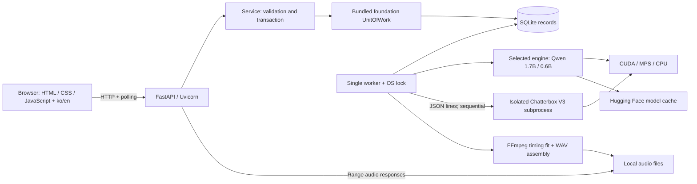

# OwnVoice 아키텍처

OwnVoice는 단일 사용자 localhost 웹 앱입니다. Java 서버, 프런트엔드 빌드 서버,
Redis, 외부 작업 큐는 필요하지 않습니다. Python foundation 소스를 함께 배포합니다.

## 책임 분리

작업의 `engine`, `engine_name`, `model`은 생성 시 저장됩니다. 기존 작업은 Qwen으로
처리합니다. Chatterbox는 NumPy/PyTorch/Transformers 버전 충돌을 피하도록 별도
Python 환경에서 실행됩니다. worker가 자식 프로세스를 소유하며 모델 전환·종료 시
정리합니다. 모델은 동시에 두 개를 실행하지 않습니다. 단계 이벤트와 WAV를 전달하고
SRT 시간 맞춤·재시도·최종 조립은 공통 worker에서 수행합니다.

| 모듈 | 책임 |
|---|---|
| `cli.py` | 환경 점검, 모델 다운로드, 웹/worker 시작·종료 |
| `app.py` | HTTP, 업로드·다운로드, localhost 경계, 요청 언어 |
| `domain.py` | 입력 DTO와 SRT 파싱·범위 검증 |
| `service.py` | 목소리·작업 생성, 수정, 재시도, 복구; 트랜잭션 경계 |
| `repository.py` | `records` 테이블 조회·저장; 직접 commit하지 않음 |
| `worker.py` | 단일 처리 루프, 구간 캐시, 재시도, 진행 기록, 최종 조립 |
| `engine.py` | 장치 선택, 모델·참조 프롬프트 메모리 캐시, 실제 합성 |
| `audio.py` | 참조 변환, 속도 제한, 샘플 단위 길이 맞춤, 원자적 저장 |
| `progress.py`, `telemetry.py` | 실측 시간·장치 정보·실측 기반 예상 시간 |
| `i18n.py`, `static/i18n.js`, `static/locales/` | 한국어·영어 표시; 저장 데이터는 변경하지 않음 |

## 생성 흐름

1. 브라우저가 음성과 대본을 등록합니다. FFmpeg가 mono 24 kHz 참조 WAV로 변환합니다.
2. 텍스트/SRT를 검증하고 `queued` 작업을 DB에 저장합니다.
3. OS 잠금을 가진 worker만 작업을 `running`으로 가져갑니다.
4. 모델은 최초 필요 시 내려받아 메모리에 올립니다. 참조 프롬프트는 프로세스 안에서 재사용합니다.
5. 구간별로 합성하고 SRT 배정 시간에 맞춥니다. 필요하면 같은 문장으로 최대 3회 시도합니다.
6. 짧은 음성 뒤에는 무음을 넣고, 긴 음성은 최대 1.15배 가속합니다. 자르거나 시각을 밀지 않습니다.
7. 모든 구간이 맞으면 임시 파일을 `output.wav`로 교체합니다. 초과가 남으면 `needs_review`입니다.

일반 예외는 `failed`로 기록합니다. 프로세스 강제 종료처럼 기록을 마치지 못한 `running`
작업은 다음 worker가 복구합니다. 완료된 구간은 재사용합니다. 수동 편집은 해당 구간만 무효화합니다.

## 프로세스와 동시성

`ownvoice start`가 웹과 worker 자식 프로세스를 관리합니다. 둘은 같은 DB·데이터 경로를
사용하고 모델은 worker에만 적재합니다. SQLite 트랜잭션은 foundation UnitOfWork가 관리합니다.
`worker.lock`은 프로세스 수명 전체에 걸쳐 유지됩니다. heartbeat는 5초마다 갱신합니다.
브라우저는 4초마다 조회합니다. 재생 중인 오디오와 편집 중인 텍스트를 polling으로 교체하지 않습니다.
Windows는 자식 프로세스 그룹과 CTRL_BREAK를 사용하고 종료 제한시간 후 강제 종료합니다.

## API와 i18n

주요 API는 `/api/runtime`, `/api/profiles`, `/api/jobs`, 작업 상세·retry·구간 PATCH·audio입니다.
변경 요청에는 `X-OwnVoice: 1`이 필요합니다. 외부 Origin과 localhost 이외 Host는 거부합니다.
인증 서버가 없으므로 인터넷에 노출하는 서비스가 아닙니다.

상단 화면 언어는 `ko`/`en`이며 브라우저에 저장합니다. 최초에는 브라우저 언어를 사용합니다.
음성 생성 언어 선택과는 독립적입니다. API는 `Accept-Language`를 해석하고 표시용 오류만 번역합니다.
번역은 한국어 원문 msgid와 `{0}` 같은 자리표시자를 쓰는 JSON 카탈로그로 관리합니다.
추가 언어는 같은 키·자리표시자를 제공하고 언어 선택/협상 목록을 확장하면 됩니다.
기존 DB의 알려진 한국어 오류도 응답 시 번역합니다. 사용자 이름·대본·SRT는 번역하지 않습니다.
CLI 설치 안내는 현재 한국어/영어 고정 문구이며 UI 언어 선택과 연동하지 않습니다.

## 한계

CUDA 감지 성공은 실제 합성 성공을 뜻하지 않습니다. Windows CPU 테스트와 CUDA 실기기 추론도
구분합니다. 자동 재시도는 시간 맞춤 가능성을 높이지만 발화 내용이나 음질을 보증하지 않습니다.
분산 worker, 동시 GPU 합성, 사용자별 fine-tuning, 원격 인증, 자동 DB 마이그레이션은 범위 밖입니다.

[저장·복구](storage.md) · [라이브러리 명세](libraries.md) · [플랫폼별 실행](platforms.md)
